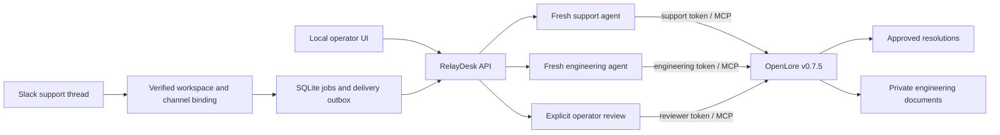

# Architecture

## Boundaries

- Slack bot token: event intake and scoped messaging; no OpenLore authority by itself.
- Channel/user/workspace binding: chooses the permitted workflow in server code.
- Support token: approved/support collections; neither engineering knowledge nor pending contributions.
- Engineering token: approved/engineering/contribution collections; never support procedures.
- Reviewer token: only explicit approval operations, never an agent capability.
- Model responses are untrusted. Domain tools validate arguments and fixed write destinations.
- Retrieved documents and customer reports are data; model instructions prohibit executing embedded instructions.
- Private engineering runs are not copied into support model conversations or support evidence exports.
- Proposal text is deliberately available to engineering contributors and reviewers. Support cannot read the draft inbox. Nominated review determines what becomes approved. The app does not claim that permissions can retract private content already copied into a shared document.

## Review transaction

Check nominated reviewer and distinct author → verify pending proposal/source hash → read current canonical document and compare the submission baseline → conflict-checked write of the exact reviewed content → read back and confirm → record approval, actor and content hashes in SQLite. Subsequent edits need another review. A request for changes queues a fresh engineering session containing the feedback; earlier transcripts are not supplied. Remote and local stores are not one distributed transaction: a process failure after a remote write requires inspection/reconciliation, not blind replay.

`server/review-policy.mjs` defines per-docset policy. Internal working notes can be cosigned after publication; endorsements bind to exact content and attributed author. Customer-safe `/approved` requires nominated approval. These are RelayDesk application controls; OpenLore provides the underlying scoped document store.

## Slack reliability

Persist a receipt and queued job before processing model calls. Acknowledge interactive actions immediately. Use a separate persisted outbox. Deduplicate incoming Slack event IDs; use stable outgoing client message IDs. In-flight deliveries interrupted by process exit become uncertain. In-flight agent jobs require review. The app does not claim exactly-once delivery to an external API.

Before a postapproval reply is queued, the fresh support trace must include a successful read whose output hash matches the approved document. Channel membership/private visibility is rechecked immediately before sending. The actual Studio1HQ installation and observed limitations are recorded in [SLACK-E2E.md](SLACK-E2E.md).

## Pre-escalation triage

`server/triage.mjs` validates structured assessments and manages human routes. Triage uses the existing engineering principal, but the agent tool set and path wrapper allow only search/discovery/read under `/approved` and `/engineering`; no draft, write or proposal tool is available. The credential itself retains its existing engineering grants. This is application-level tool restriction on top of the scoped OpenLore identity, not a new read-only OpenLore principal.

Each cited excerpt must match a document actually read during that run. Assessments bind the current ticket/context fingerprint and source content hashes. A decision checks current source hashes, completed run, latest assessment and nominated reviewer; context/source drift blocks use. A manual handoff revalidates the reviewed route. These checks establish exact source use and freshness at the check time, not semantic correctness or an atomic snapshot across independent stores.

Internal assessments and decision text stay in local records/private engineering destinations and are excluded from support model prompts and support evidence exports. Devin/Intercom transport is absent; generating a packet records `sent: false`. New engineering investigations require a reviewed engineering route; an explicit request for changes on the latest existing proposal can continue that review revision without a new initial-routing decision.
